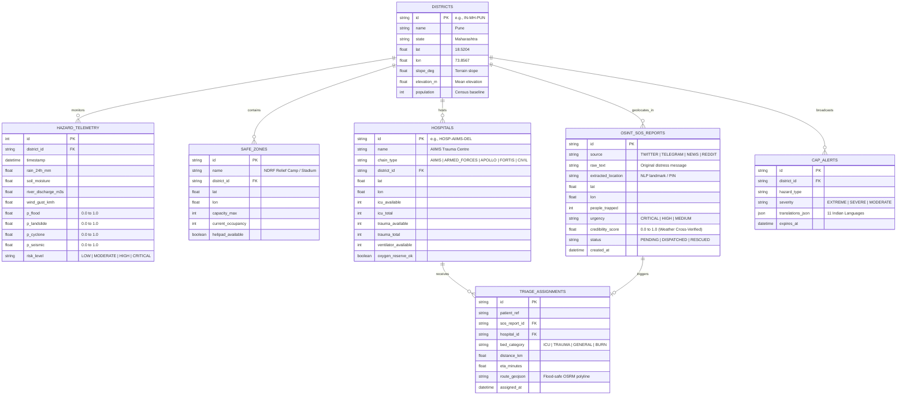

<div align="center">

# 🛡️ PRALEYE
### **Foresight Before the Storm. Precision When It Matters.**
*Autonomous Multi-Hazard Disaster Intelligence, OSINT Rescue Geolocation, & Tactical Command Platform for India*

[](https://www.python.org/)
[](https://fastapi.tiangolo.com/)
[](https://nextjs.org/)
[](https://maplibre.org/)
[](https://ollama.com/)
[](https://www.sqlite.org/)
[](./docs/05_LOCAL_LLM_AND_TESTING_STRATEGY.md)

[Architecture](#-system-architecture) •
[Core Capabilities](#-core-capabilities) •
[Mathematical Models](#-prediction--triage-mathematics) •
[Database Schema](#-database-schema--erd) •
[4-Edge HUD Design](#-map-first-4-edge-tactical-hud) •
[Quickstart (60s)](#-instant-60-second-quickstart) •
[Documentation](./docs/00_MASTER_BLUEPRINT_AND_ARCHITECTURE.md)

</div>

---

<!-- Optional Hero Screenshot Banner: Drop a 1920x1080 screenshot of your Map HUD at docs/assets/hud-hero-banner.png -->
<div align="center">
  
</div>

## 🌐 Executive Overview

India loses thousands of lives and billions in infrastructure annually to sudden hydro-meteorological and seismic crises—flash floods, cloudbursts, tropical cyclones, landslides, and severe heatwaves. Existing disaster response workflows suffer from **three critical bottlenecks**:
1. **Fragmented Early Warning:** Meteorological telemetry, river gauge levels, and seismic sensors sit in isolated departmental silos without unified district-level probability synthesis.
2. **Blind Grassroots Situational Awareness:** During an active crisis, thousands of citizen distress calls (SOS) are posted across X (Twitter), Telegram, Reddit, and regional news portals, remaining unmapped and unverified.
3. **Manual Post-Disaster Triage:** Evacuation routing and emergency hospital bed allocation rely on manual phone trees, causing fatal bottlenecks at overwhelmed trauma centers.

**Praleye** solves this through a unified, **zero-external-infrastructure** command platform. It fuses keyless real-time meteorological/seismic telemetry, autonomous OSINT social media scraping with Indian Geo-NER location extraction, deterministic hazard probability engines, automated multi-hospital bed triage, CAP v1.2 multilingual alerts, and an on-device **Local LLM (Ollama)** that generates defense-grade Situational Reports (SITREPs) for the Government of India, NDRF, and the Indian Armed Forces.

---

## 🏗️ System Architecture

Praleye is engineered for **zero-configuration resilience** and **sub-second spatial rendering**. It eliminates heavy external servers in favor of embedded **SQLite in Write-Ahead Logging (WAL) mode** with spatial indexing, a hybrid in-memory/disk TTL cache, asynchronous Python workers, and a WebGL-accelerated **MapLibre GL + Deck.gl** tactical HUD.

<div align="center">
  
</div>

## ⚙️ System Workflow & Processing Pipeline

The Praleye workflow processes asynchronous multi-source inputs through deterministic prediction and NLP extraction engines to output real-time, actionable emergency responses.

<div align="center">
  
</div>

### Workflow Stages:
1. **Input Layer (Telemetry & OSINT):** Polls free real-time weather, seismic, and hydrological APIs alongside scrapers for X, Telegram, and regional news feeds.
2. **Core Processing Engine (FastAPI):** Computes hazard probabilities via physical models and extracts precise coordinates using a 3-stage Indian Geo-NER pipeline.
3. **Outputs & Actions:** Delivers verified SOS pins, automated ICU bed locks, OSRM safe-zone evacuation routes, and 11-language CAP alerts.

## 🔄 End-to-End Operational Lifecycle

Praleye bridges the critical gap between early meteorological detection and post-disaster medical recovery through a synchronized, 3-phase crisis management lifecycle.

<div align="center">
  
</div>

### Lifecycle Breakdown:
* **Phase 1: Pre-Disaster Prediction & Early Warning:** Continuously ingests telemetry to compute district-level risk probabilities and trigger proactive CAP alerts before landfall.
* **Phase 2: Active Disaster Response & OSINT Geolocation:** Automatically ingests live social media distress calls, cross-verifies them against radar telemetry to filter out fake news, and plots verified SOS pins on the live map.
* **Phase 3: Post-Disaster Recovery, Triage & SITREPs:** Automatically assigns incoming casualties to optimal hospital beds via OSRM flood-safe routing, while synthesizing 24-hour telemetry into local AI military SITREPs.

---

## 🔥 Core Capabilities

### 1. Pre-Disaster Multi-Hazard Prediction Engine

* **100% Free, Keyless Telemetry:** Polls Open-Meteo (Forecast, Flood GloFAS, Air Quality), USGS Earthquake API, GDACS Global Disaster Alerts, and IMD public RSS feeds on non-blocking async intervals.
* **District-Granular Risk Scoring:** Calculates real-time probabilities $[0.0 - 1.0]$ for **Flash Floods**, **Landslides**, **Tropical Cyclones**, **Earthquakes**, and **Heatwaves** across Indian districts.
* **Dam Cascade & Reservoir Overflow Simulator:** Models upstream rainfall against major Indian dam capacities (Tehri, Sardar Sarovar, Idukki, Hirakud, Koyna) to project downstream inundation polygons.

### 2. Autonomous OSINT Web & Social Media Scraping Pipeline

* **Multi-Platform Ingestion:** Built on battle-tested open-source scraping libraries (`twikit` / `ntscraper` for X/Twitter, `Telethon` for public emergency Telegram channels, `trafilatura` for regional news extraction, Reddit `.json` feeds, and GDELT Project 2.0).
* **3-Stage Indian Geo-NER Engine:** Converts unstructured multilingual distress posts (e.g., *"Water entered ground floor near Kasba Peth Ganpati Mandir, Pune 411011, 4 elderly trapped"*) into exact `[lat, lon]` coordinates using **SpaCy NER**, a custom **Indian PIN-Code & Landmark Gazetteer**, and **Nominatim/Photon geocoding**.
* **Automated Fake-News Cross-Verifier:** Assigns a **Credibility Score ($0-100\%$)** to every scraped social media post by cross-checking its claimed hazard against actual physical sensor telemetry at that coordinate.

### 3. Map-First 4-Edge Tactical HUD

Designed with human-crafted GIS ergonomics inspired by **Palantir Gotham**, **Windy**, and **Flightradar24**:

* **Top Horizontal Strip:** Instant geocoder search (State, District, Tehsil, PIN Code, Landmark) + toggleable telemetry layer pills (`Rain Radar`, `Wind Vectors`, `River Gauges`, `Seismic Rings`, `Hospital Nodes`, `SOS Clusters`).
* **Bottom Horizontal Strip:** 4 Operational Mode Switchers (`PRE-DISASTER FORECAST`, `LIVE OSINT RESCUE`, `SAFE-ZONE EVACUATION`, `POST-DISASTER TRIAGE`) + an interactive **72-Hour Disaster Time-Machine** scrubber.
* **Left Vertical Dock:** Role-based command navigation, active CAP alert ticker, and Departmental Quick-Dispatch.
* **Right Vertical Depth Drawer:** Contextual drill-down showing district hazard math breakdowns, live OSINT post evidence, OSRM turn-by-turn evacuation corridors, and the Local AI SITREP console.

### 4. Automated National Hospital Bed Triage & Safe-Zone Routing

* **Pre-Seeded Indian Hospital Network:** Ships with a realistic, stateful database of major Indian medical nodes (AIIMS New Delhi/Rishikesh/Bhubaneswar, Armed Forces Command Hospitals, Apollo, Fortis, Manipal, and District Civil Hospitals) tracking live **ICU**, **Trauma**, **General**, **Burn**, and **Ventilator** vacancies.
* **Zero-Touch Emergency Bed Assignment:** Automatically matches incoming rescue casualties to the optimal hospital using OSRM road travel time, flood-zone polygon avoidance, and real-time ICU load balancing.

### 5. Local LLM Military SITREPs & 11-Language Voice Command

* **Air-Gapped Ollama Integration:** Runs `llama3.2:3b` or `qwen2.5:7b-instruct` locally on GPU/CPU to synthesize nation-wide telemetry into structured **Defense & NDRF Situational Reports (SITREPs)**, plus IAF Helipad weather clearance checks.
* **Multilingual CAP Alerts & Voice Actions:** Generates alert payloads and hands-free voice announcements across **11 Indian languages** (`Hindi`, `Marathi`, `Tamil`, `Telugu`, `Bengali`, `Gujarati`, `Kannada`, `Malayalam`, `Punjabi`, `Odia`, `English`).

---

## 🧮 Prediction & Triage Mathematics

Praleye avoids "black-box" guesswork by combining deterministic physical indices with weighted logistic risk models:

### 1. Composite Flood Probability ($P_{\text{flood}}$)

$$P_{\text{flood}} = \sigma\left( w_1 \cdot \hat{R}_{24\text{h}} + w_2 \cdot \hat{M}_{\text{soil}} + w_3 \cdot \hat{Q}_{\text{river}} + w_4 \cdot \hat{E}_{\text{inv}} - \beta_0 \right)$$

Where:

* $\hat{R}_{24\text{h}} = \min\left(1, \frac{\text{Precip}_{24\text{h}}}{150\text{ mm}}\right)$ is normalized 24-hour cumulative precipitation.
* $\hat{M}_{\text{soil}} \in [0, 1]$ is volumetric surface soil moisture saturation ($0-7\text{ cm}$ depth).
* $\hat{Q}_{\text{river}} = \min\left(1, \frac{Q_{\text{current}}}{Q_{\text{flood\_threshold}}}\right)$ is GloFAS river discharge ratio.
* $\hat{E}_{\text{inv}}$ is inverse terrain elevation factor, with weights $w_1=0.38, w_2=0.22, w_3=0.30, w_4=0.10$.

### 2. Landslide Susceptibility Index ($P_{\text{landslide}}$)

$$P_{\text{landslide}} = \text{clip}\left( \left(\frac{\theta_{\text{slope}}}{45^\circ}\right)^{1.3} \times \left(0.55 \cdot \hat{R}_{72\text{h}} + 0.45 \cdot \hat{M}_{\text{soil}}\right) \times \gamma_{\text{lithology}}, \; 0.0, \; 1.0 \right)$$

### 3. Automated Emergency Hospital Triage Score $S(p, h)$

When assigning a casualty $p$ at location $L_p$ with severity $k \in \{\text{CRITICAL}, \text{MODERATE}, \text{MINOR}\}$ to candidate hospital $h \in H$:

$$\text{Score}(p, h) = \alpha \cdot \left(\frac{1}{1 + T_{\text{OSRM}}(L_p, L_h)}\right) + \beta \cdot \left(\frac{B_{h,\text{avail}}^{(k)}}{B_{h,\text{total}}^{(k)}}\right) - \gamma \cdot I_{\text{flood\_intersect}}(\text{Route}(L_p, L_h))$$

*Hospitals with zero specialty beds ($B_{h,\text{avail}}^{(k)} = 0$) or routes intersecting active inundation polygons ($I_{\text{flood\_intersect}} = 1$) are automatically filtered out or penalized, and an atomic SQLite transaction locks the bed upon assignment.*

---

## 🗄️ Database Schema & ERD

Praleye uses an embedded, high-concurrency **SQLite 3 (`PRAGMA journal_mode=WAL;`)** database that auto-initializes and seeds on first boot:



---

## 🖥️ Map-First 4-Edge Tactical HUD

Praleye rejects generic AI dashboard templates in favor of a **100vw × 100vh full-bleed WebGL Map Canvas** surrounded by a high-contrast Obsidian Slate (`#090D16`) tactical glass HUD:

```text
+--------------------------------------------------------------------------------------------------+
| [🛡️ PRALEYE]  [🔍 Search City, District, PIN, Landmark...]   [🌧️ Rain] [🌊 Flood] [📡 SOS] [🏥 Beds] | <-- TOP EDGE: Search & Layer Filters
+--------------+--------------------------------------------------------------------+--------------+
|              |                                                                    |              |
|  LEFT DOCK   |                                                                    | RIGHT DRAWER |
|  (Category   |                                                                    | (Contextual  |
|   & Roles)   |                                                                    |  Depth Info) |
|              |                   100vw x 100vh WEBGIS CANVAS                      |              |
|  [🗺️ Map]    |                 (MapLibre GL JS + Deck.gl Layers)                  | 📊 District  |
|  [📡 OSINT]  |                                                                    |    Risk Math |
|  [🏥 Triage] |               • Pulsing Red/Amber Hazard Hexagons                  |              |
|  [🪖 Army]   |               • Geotagged OSINT SOS Distress Clusters              | 🆘 Live SOS  |
|  [📢 CAP]    |               • Animated OSRM Safe-Zone Evacuation Arcs            |    Inspector |
|  [🎙️ Voice]  |               • Hospital Capacity Beacons (Green/Amber/Red)        |              |
|              |                                                                    | 🧠 Ollama    |
|  ----------  |                                                                    |    Military  |
|  Active:     |                                                                    |    SITREP    |
|  14 Alerts   |                                                                    |              |
+--------------+--------------------------------------------------------------------+--------------+
|  MODE: [ ⚡ 1. PRE-DISASTER ]  [ 🆘 2. LIVE OSINT RESCUE ]  [ 🛣️ 3. SAFE ZONES ]  [ 🏥 4. TRIAGE ] | <-- BOTTOM EDGE: Mode Switcher
|  TIMELINE: [⏮️ -24h] ================●================================ [⏭️ +48h Forecast] [🔊 HI/EN] |     & Disaster Time-Machine
+--------------------------------------------------------------------------------------------------+

```

| Pre-Disaster Hazard Forecast | Live OSINT Rescue & Geo-NER |
| --- | --- |
|  |  |
| **Post-Disaster Hospital Auto-Triage** | **Military / NDRF Local LLM SITREP** |
|  |  |

---

## 📂 Repository File Architecture

```text
praleye/
├── .env.example                           # Zero-config environment template (runs out-of-the-box)
├── .gitignore                             # Production monorepo ignore rules
├── README.md                              # Project documentation & system blueprints
├── docs/                                  # Modular engineering specifications
│   ├── 00_MASTER_BLUEPRINT_AND_ARCHITECTURE.md
│   ├── 01_DATA_INGESTION_AND_PREDICTION_ENGINE.md
│   ├── 02_OSINT_WEB_AND_SOCIAL_SCRAPING.md
│   ├── 03_UI_UX_MAP_FIRST_DESIGN_SYSTEM.md
│   ├── 04_HOSPITAL_TRIAGE_AND_DASHBOARDS.md
│   ├── 05_LOCAL_LLM_AND_TESTING_STRATEGY.md
│   └── requirements.md                    # System dependency manifests
│
├── backend/                               # Python 3.11+ FastAPI Backend
│   ├── requirements.txt
│   ├── pytest.ini
│   ├── data/                              # Auto-generated SQLite WAL DB & Seed JSONs
│   │   ├── seed_hospitals_india.json
│   │   ├── seed_districts_india.json
│   │   └── seed_safe_zones.json
│   ├── app/
│   │   ├── main.py                        # FastAPI Entrypoint + Lifespan Auto-Seeder
│   │   ├── core/                          # Config, SQLite WAL engine, Hybrid Cache, WebSockets
│   │   ├── modules/
│   │   │   ├── ingestion/                 # Open-Meteo, GloFAS, USGS, IMD pollers
│   │   │   ├── prediction/                # Flood, Landslide, Cyclone, Seismic, Dam math engines
│   │   │   ├── osint_scraper/             # Twikit, Telethon, Trafilatura, Indian Geo-NER, Verifier
│   │   │   ├── routing_safezones/         # OSRM safe-zone evacuation & helipad validator
│   │   │   ├── hospitals/                 # Hospital network CRUD & automated bed triage engine
│   │   │   ├── alerts_multilingual/       # CAP v1.2 XML builder, SMS gateway, 11-lang translator
│   │   │   └── local_llm/                 # Ollama military SITREP generator & tactical RAG chat
│   │   └── api/v1/                        # Modular REST & WebSocket routers
│   └── tests/                             # Comprehensive Pytest unit & integration suite
│       ├── unit/
│       └── integration/
│
└── frontend/                              # Next.js 14 (App Router) + TypeScript + Tailwind CSS
    ├── package.json
    ├── src/
    │   ├── app/                           # Map HUD root + Admin, Department, & Hospital portals
    │   ├── components/
    │   │   ├── map/                       # MapLibre GL canvas, Deck.gl hazard/SOS/route layers
    │   │   ├── hud/                       # TopFilterBar, BottomModeBar, LeftCategoryNav, RightDepthPanel
    │   │   ├── dashboards/                # NDMA Admin, Army/NDRF/Fire Tactical, Hospital Chain views
    │   │   └── voice/                     # 11-Language Web Speech TTS/STT Voice Command Dispatcher
    │   ├── store/                         # Zustand reactive spatial & telemetry state
    │   └── lib/                           # API clients, WebSocket hooks, offline i18n dictionaries
    └── __tests__/                         # Vitest component & store unit tests

```

---

## 🚀 Instant 60-Second Quickstart

Praleye is architected so evaluators and developers can clone and launch the entire stack in **under 60 seconds** with **zero paid API keys** and **zero external database installations**.

### Prerequisites

* **Python `3.11+**` (with `uv` or `pip`)
* **Node.js `20.x+**`
* **Ollama** *(Optional — for Local LLM Military SITREPs; automatically falls back to deterministic template synthesis if Ollama is offline)*

### 1. Clone & Configure Environment

```bash
git clone [https://github.com/your-username/praleye-core.git](https://github.com/your-username/praleye-core.git)
cd praleye-core
cp .env.example .env

```

### 2. Boot the Backend Engine (Terminal 1)

```bash
cd backend

# Create virtual environment & install dependencies
python -m venv .venv
source .venv/bin/activate          # Windows PowerShell: .venv\Scripts\Activate.ps1
pip install -r requirements.txt

# Download the lightweight 12MB SpaCy model for Indian Geo-NER
python -m spacy download en_core_web_sm

# Launch FastAPI server (Auto-creates SQLite WAL DB & seeds Indian hospitals/districts)
uvicorn app.main:app --reload --host 0.0.0.0 --port 8000

```

* **Interactive Swagger API Docs:** `http://localhost:8000/docs`

### 3. Boot the Map-First Tactical HUD (Terminal 2)

```bash
cd frontend
npm install
npm run dev

```

* **Tactical Map HUD:** `http://localhost:3000`
* **NDMA / Admin Command Center:** `http://localhost:3000/dashboard/admin`
* **Army / NDRF / Fire Department Ops:** `http://localhost:3000/dashboard/department`
* **Hospital Network Triage Portal:** `http://localhost:3000/dashboard/hospital`

### 4. Enable Local LLM Military SITREPs (Optional)

```bash
ollama pull llama3.2:3b
ollama serve

```

---

## 🧪 Running the Automated Test Suite

Praleye enforces strict unit and integration test coverage across its mathematical models, Geo-NER location extractor, hospital bed allocator, and HUD state stores.

```bash
# 1. Run Backend Pytest Suite (Prediction Math, Geo-NER, Hospital Triage, CAP XML)
cd backend
pytest --cov=app -v

# 2. Run Frontend Vitest Suite (4-Edge HUD State, Mode Switching, Filter Sync)
cd frontend
npm run test

```

---

## 📡 Key API Endpoints

| Method | Endpoint | Description |
| --- | --- | --- |
| `GET` | `/api/v1/predictions/india-grid` | Returns real-time multi-hazard probability GeoJSON across Indian districts |
| `POST` | `/api/v1/predictions/simulate-cascade` | Simulates upstream dam release & computes downstream flood polygons |
| `GET` | `/api/v1/osint/live-feed` | Returns geo-verified social media & web SOS distress reports |
| `POST` | `/api/v1/osint/extract-location` | Runs 3-stage Indian Geo-NER & fake-news verification on raw text |
| `GET` | `/api/v1/hospitals/network-status` | Returns real-time ICU, Trauma, Burn & Ventilator bed vacancies |
| `POST` | `/api/v1/hospitals/auto-assign-bed` | Executes atomic multi-variable emergency hospital bed triage & OSRM route |
| `POST` | `/api/v1/alerts/broadcast-cap` | Dispatches CAP v1.2 XML + priority multilingual SMS alerts |
| `POST` | `/api/v1/llm/generate-sitrep` | Streams daily Indian Armed Forces / NDMA SITREP from local Ollama LLM |
| `WS` | `/ws/live-telemetry` | Full-duplex WebSocket streaming live hazard, SOS, and bed updates |

---

## 🛡️ License

Distributed under the MIT License. Built for sovereign disaster resilience and rapid emergency response across India.

```

### 💡 Quick Tip for Maximum Visual Impact on GitHub
1. **Mermaid Diagrams Render Automatically:** The 3 diagrams above (`System Architecture`, `End-to-End Operational Lifecycle`, and `Database Schema & ERD`) use GitHub's native `mermaid` engine—the moment you push this `README.md`, GitHub will render them as interactive vector diagrams.
2. **Zero Broken Image Icons:** The `` tags for `docs/assets/*.png` include `onerror="this.style.display='none'"`—meaning if you haven't uploaded screenshots to `docs/assets/` yet, they remain cleanly hidden, and the moment you drop screenshots into `docs/assets/`, they appear automatically.

```
## Screenshots


## Demo video
https://www.youtube.com/watch?v=eJ6RobunlWE
